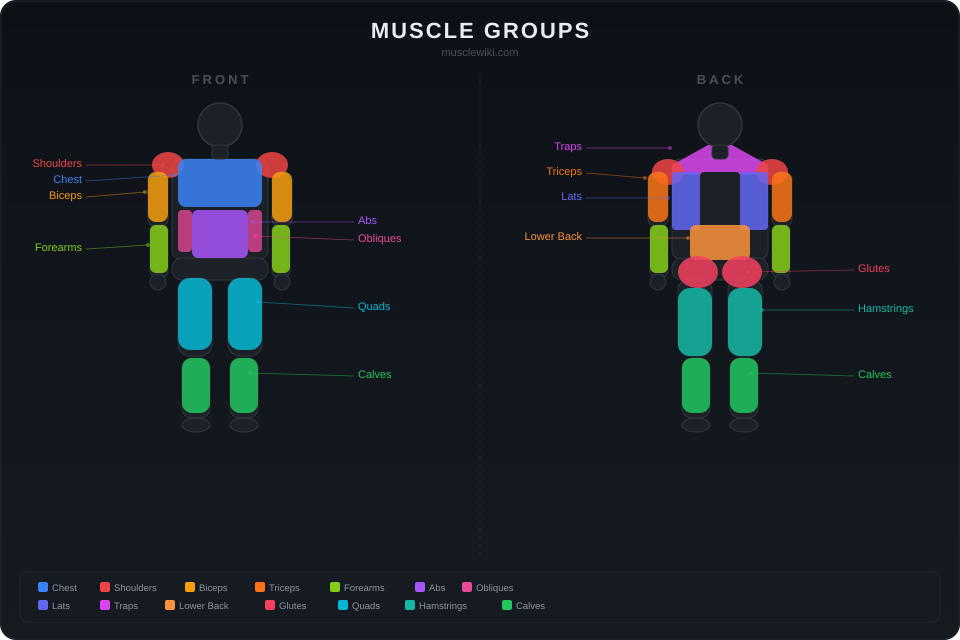

## Hey 👋

I'm **Fadhel** — coding and lifting.

- 🌱 Currently learning Python and Visual Basic
- 💞️ Looking to collaborate on small projects
- 📫 How to reach me: just post a comment

---

## 💪 Muscle Groups Reference

  

### Exercises by Muscle Group

| Split | Muscle | Exercises |
|-------|--------|-----------|
| **Push** | Chest | Bench Press, Push-ups, Cable Flyes |
| **Push** | Shoulders | Overhead Press, Lateral Raises, Face Pulls |
| **Push** | Triceps | Dips, Tricep Pushdowns, Skull Crushers |
| **Pull** | Back (Lats) | Pull-ups, Barbell Rows, Lat Pulldowns |
| **Pull** | Traps | Shrugs, Face Pulls, Deadlifts |
| **Pull** | Biceps | Barbell Curls, Chin-ups, Hammer Curls |
| **Pull** | Forearms | Wrist Curls, Reverse Curls, Farmer's Walk |
| **Legs** | Quads | Squats, Leg Press, Lunges |
| **Legs** | Hamstrings | Romanian Deadlifts, Leg Curls, Nordic Curls |
| **Legs** | Glutes | Hip Thrusts, Bulgarian Split Squats, Step-ups |
| **Legs** | Calves | Standing Calf Raises, Seated Calf Raises |
| **Core** | Abs | Planks, Hanging Leg Raises, Cable Crunches |
| **Core** | Obliques | Russian Twists, Side Planks, Woodchops |
| **Core** | Lower Back | Hyperextensions, Good Mornings |

> 📖 Explore exercises with video demos at [musclewiki.com](https://musclewiki.com)

<!---
0xFadhel/0xFadhel is a ✨ special ✨ repository because its `README.md` (this file) appears on your GitHub profile.
You can click the Preview link to take a look at your changes.
--->
